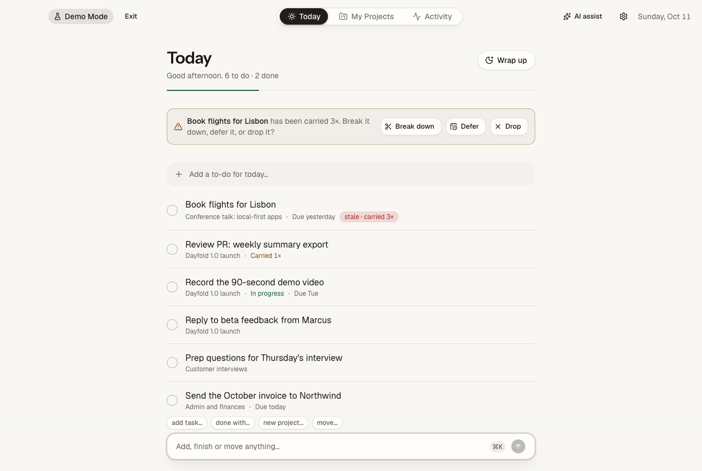
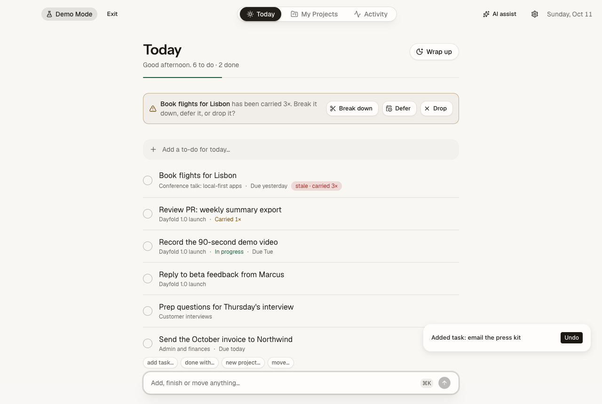
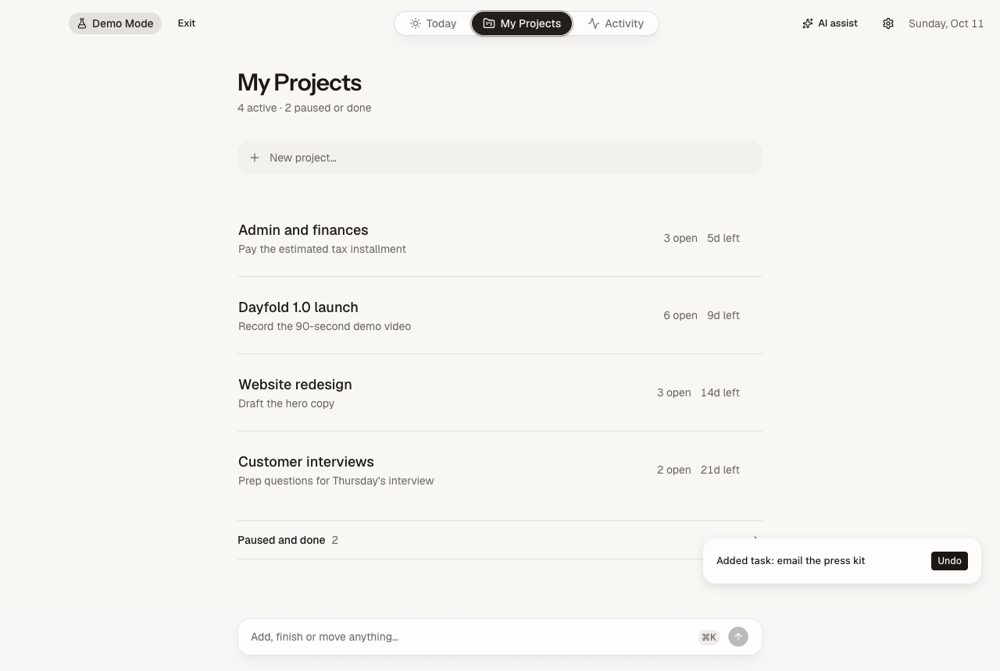
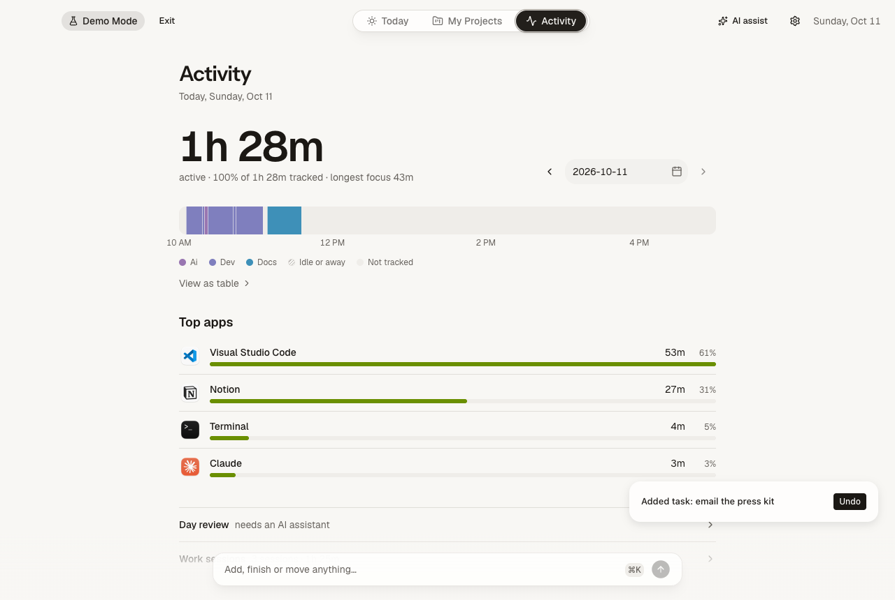

# Dayfold

A local-first personal productivity dashboard for macOS (Electron, React, TypeScript).



## Built for voice

Dayfold is designed to be **spoken to**. Almost every change goes through one plain-language command
bar, so you can run your whole day by dictating with [Wispr Flow](https://wisprflow.ai) (or any
dictation tool). There are no forms to fill in and no dropdowns to aim at.

1. Press `⌥Space` from any app, or `⌘K` inside Dayfold.
2. Hold your Wispr Flow key and talk: _"add task send the report to Atlas by friday"_, then _"done with the invoice"_.
3. Dayfold parses what you said, applies it and shows a toast with **Undo**.

Why it works well with dictation:

- **Forgiving parsing.** Names are matched loosely (`done with the invoice` finds "Send the October
  invoice"), and dates are spoken the way people say them (`tomorrow`, `next monday`, `in 3 days`).
  Dictation rarely gives you exact titles, so the app does not ask for them.
- **Nothing is lost.** If a command is not understood, your words go to the **Inbox** instead of being
  dropped, so a misheard sentence costs nothing.
- **Safe to talk at.** If two items match, Dayfold shows a short list to pick from rather than
  guessing. Every change is undoable with `⌘Z` or by saying `undo`.
- **Hands-free capture.** `⌥Space` opens a small bar over whatever you are doing, so a thought is
  saved in a few seconds without switching apps.

Dayfold does not ship its own speech recognition; the transcript comes from your dictation tool and
lands in a normal text field. That keeps audio on your terms and everything else on your Mac.
See the [demo script](docs/DEMO_SCRIPT.md) for a walkthrough.

<p align="center">
  
  
</p>
<p align="center">
  
</p>

## Install

1. Download **`Dayfold-<version>-universal.dmg`** from the
   [latest release](https://github.com/crstnmac/Dayfold/releases/latest). It runs on Apple Silicon and
   Intel Macs with macOS 12 or newer.
2. Open it and drag **Dayfold** to **Applications**.
3. The first time you open it, macOS will block it, because the app is not notarized by Apple (that
   needs a paid developer account). Allow it once in **System Settings, Privacy & Security, Open
   Anyway**, or run `xattr -dr com.apple.quarantine /Applications/Dayfold.app`.

The full walkthrough, with what to expect at each prompt, troubleshooting, Accessibility
permission and updating, is in **[docs/INSTALL.md](docs/INSTALL.md)**. Prefer to build it yourself?
`npm ci && npm run build:mac:unsigned`.

## Using Dayfold

Dayfold has three tabs: **Today** (your plate, the backlog and your Inbox), **My Projects**, and
**Activity** (optional, local time tracking). Almost everything is done from the **command bar** at
the bottom, in plain language.

| Shortcut | What it does                                                                         |
| -------- | ------------------------------------------------------------------------------------ |
| `⌥Space` | Capture from any app: a small bar appears, type, press Enter. It goes to your Inbox. |
| `⌘K`     | Focus the command bar.                                                               |
| `⌘Z`     | Undo the last change (same as typing `undo`).                                        |

Every change shows a toast with **Undo**, and nothing is lost: if Dayfold does not understand
something, it saves your words to the **Inbox** (the section at the bottom of Today) so you can sort
it later.

### Command reference

Names are matched loosely. `done with the invoice` finds "Send the October invoice". If two things
match, Dayfold shows a short list to pick from instead of guessing. Dates understand `today`,
`tomorrow`, weekdays (`friday`, `next monday`), `next week`, `in 3 days` and calendar dates.

#### Add

| Say                                                                         | Result                                                             |
| --------------------------------------------------------------------------- | ------------------------------------------------------------------ |
| `add buy milk` · `todo buy milk` · `task: buy milk`                         | A new task.                                                        |
| `add buy milk tomorrow`                                                     | A task planned for tomorrow.                                       |
| `add send report by friday`                                                 | A task with a due date (`by`, `due` or `before` set the due date). |
| `add task review contract to Website redesign`                              | A task in a project (`to`, `in`, `for` or `under`).                |
| `remind me to call mum` · `I need to call mum` · `don't forget to pay rent` | A task.                                                            |
| `due friday: send the report`                                               | A task with a due date.                                            |
| `new project Podcast, goal publish episode one`                             | A project, with an optional goal and `due` date.                   |
| `note on Atlas: decided to use SQLite`                                      | Appends a note to a project.                                       |
| `dump: an idea` · `add buy milk to the inbox`                               | Straight to the Inbox.                                             |

#### Change tasks

| Say                                                                                                                                                                | Result                                            |
| ------------------------------------------------------------------------------------------------------------------------------------------------------------------ | ------------------------------------------------- |
| `done with the invoice` · `finish X` · `check off X` · `tick off X` · `I finished X` · `done: X`                                                                   | Mark done.                                        |
| `start X` · `begin X` · `working on X`                                                                                                                             | Mark in progress.                                 |
| `stop X`                                                                                                                                                           | Back to to-do.                                    |
| `reopen X` · `undone X` · `mark X as not done`                                                                                                                     | Bring a finished task back.                       |
| `move X to tomorrow` · `push X to friday` · `plan X for monday` · `schedule X for friday` · `reschedule X to monday` · `postpone X to next week` · `do X tomorrow` | Plan it for a day.                                |
| `set due date for X to friday`                                                                                                                                     | Set a due date.                                   |
| `defer X to friday`                                                                                                                                                | Reschedule on purpose (resets the carried count). |
| `carry X to tomorrow`                                                                                                                                              | Carry it over (counts as one more carry).         |
| `carry everything to tomorrow` · `carry over`                                                                                                                      | Carry the whole plate over.                       |
| `break down X into a, b and c`                                                                                                                                     | Replace a task with two to five smaller ones.     |
| `rename X to Y`                                                                                                                                                    | Rename a task, project or Inbox item.             |
| `drop X`                                                                                                                                                           | Drop a task.                                      |
| `delete X`                                                                                                                                                         | Delete a task, project or Inbox item.             |

`drop all` and `delete everything` are refused on purpose. Use **Wrap up** to clear the day.

#### Projects

| Say                                                            | Result                |
| -------------------------------------------------------------- | --------------------- |
| `pause Atlas` · `park Atlas` · `mark Atlas as paused`          | Pause a project.      |
| `resume Atlas` · `unpause Atlas` · `mark Atlas as active`      | Make it active again. |
| `complete project Atlas` · `archive Atlas` · `mark Atlas done` | Finish a project.     |
| `set deadline for Atlas to friday` · `Atlas is due friday`     | A project deadline.   |
| `set next action for Atlas: call Sam`                          | Set the next action.  |

#### Sort and plan

| Say                                                           | Result                                                             |
| ------------------------------------------------------------- | ------------------------------------------------------------------ |
| `sort my tasks` · `prioritize my tasks` · `organize my plate` | Priority order: overdue, due today, in progress, then soonest due. |
| `sort by due date`                                            | Soonest due first, undated last.                                   |
| `sort by project`                                             | Grouped by project name.                                           |
| `sort by newest first`                                        | Newest tasks first.                                                |
| `reset the sort` · `sort by default`                          | Back to the default order (most carried first).                    |
| `what should I do next` · `what's next`                       | Suggests the top task and why. Changes nothing.                    |

The sort applies to Today, the backlog and project task lists, and is remembered until you change
it. It can be undone.

#### Ask

These only read your data and never change it.

| Say                                                                 | Result                                         |
| ------------------------------------------------------------------- | ---------------------------------------------- |
| `what's due today` · `what's due this week` · `what's due tomorrow` | The tasks due then.                            |
| `what is overdue`                                                   | Overdue tasks.                                 |
| `tasks for tomorrow` · `what's tomorrow`                            | What is planned for tomorrow.                  |
| `how many tasks do I have`                                          | Counts for today, open, overdue and the Inbox. |
| `help` · `what can I say`                                           | A short list of commands.                      |

#### Go to

| Say                                                             | Result                        |
| --------------------------------------------------------------- | ----------------------------- |
| `show projects` · `list my projects`                            | Open My Projects.             |
| `show my tasks` · `what's on my plate` · `what do I have today` | Open Today.                   |
| `show inbox` · `show backlog`                                   | Open Today at the Inbox.      |
| `open activity` · `show activity`                               | Open Activity.                |
| `wrap up` · `end my day` · `plan tomorrow`                      | Start the end-of-day wrap-up. |
| `undo`                                                          | Undo the last change.         |

### Wrap-up

Press **Wrap up** (or say `wrap up`) at the end of the day. It walks through today's tasks, then your
Inbox, then tomorrow's list. Keys: **D** done, **C** carry, **F** defer, **X** drop, **B** break
down, **U** undo, **Enter** to confirm, arrows to move between tasks. A task carried three times is
flagged as stale and Dayfold asks you to break it down, defer it, or drop it. Each wrap-up is saved
with what you did, and consecutive days build a streak. Dayfold can remind you at a set time
(default 17:30) in Settings.

### Activity (optional)

Off by default. When on, Dayfold records which app is in front and for how long, and groups it into
work sessions you can turn into to-dos. Password managers are excluded by default, and everything
stays on your Mac. To also record window titles and sites, allow Dayfold under **System Settings,
Privacy & Security, Accessibility**. Without it only app names are tracked. Because this build is
not signed with a developer certificate, macOS may ask again after you reinstall: remove the old
Dayfold entry and add it again.

### Demo Mode

**Settings, Demo Mode, Start Demo Mode** restarts Dayfold on a separate database filled with
realistic sample projects, tasks, wrap-ups and a week of activity. Your own data is not opened or
changed, and tracking and backups are off while it is on. Each start builds fresh sample data
relative to today. Use **Exit** in the header (or Settings) to go back. A script for recording a
walkthrough is in [docs/DEMO_SCRIPT.md](docs/DEMO_SCRIPT.md).

### Your data

Everything lives in one SQLite file on your Mac, with a daily backup (14 kept). Settings has
**Back up now**, **Restore from backup**, **Export** (JSON or Markdown) and **Delete all data**.

## Recommended IDE Setup

- [VSCode](https://code.visualstudio.com/) + [ESLint](https://marketplace.visualstudio.com/items?itemName=dbaeumer.vscode-eslint) + [Prettier](https://marketplace.visualstudio.com/items?itemName=esbenp.prettier-vscode)

## Project Setup

### Install

```bash
$ npm install
```

### Development

```bash
$ npm run dev
```

### Build and release

```bash
$ npm run build:mac     # builds the Swift helper, the app, then a universal .dmg/.zip in ./dist
$ npm run build:unpack  # unpacked .app only (fast, for testing)
$ npm run test:e2e      # builds, then drives the app with Playwright
```

Dayfold is macOS only. `npm run build:mac:unsigned` makes the same ad-hoc signed `.dmg` that the
[Release workflow](.github/workflows/release.yml) publishes when you push a `v*` tag. For a signed and
notarized release (needs an Apple Developer ID) follow [docs/RELEASE.md](docs/RELEASE.md). There is no
auto-update feed yet.

## AI assist (Claude or Codex subscription)

Optional. When the rule parser doesn't understand an input, Dayfold can ask your signed-in
**Claude Code** or **Codex** CLI to interpret it, using your subscription, with no API key stored.

1. Sign in once in a terminal: `claude` (Claude account) and/or `codex login` (ChatGPT account).
2. In Dayfold, open **AI assist** in the header, pick a provider, **Save**, then **Test connection**.

How it works (`src/main/llm/`): the CLI runs headless with no tools, in an empty temp folder,
with API-key env vars removed (so it can never bill an API account). The model returns
schema-constrained JSON; Dayfold validates every command and id before applying (ADR-0003), and each
change is undoable. If anything fails, your text goes to your Inbox. Rule-matched input never
leaves your Mac.

Tests: `npm test` (mocked). Real CLIs: `DASH_LIVE_LLM=1 npx vitest run tests/llm.live`.
